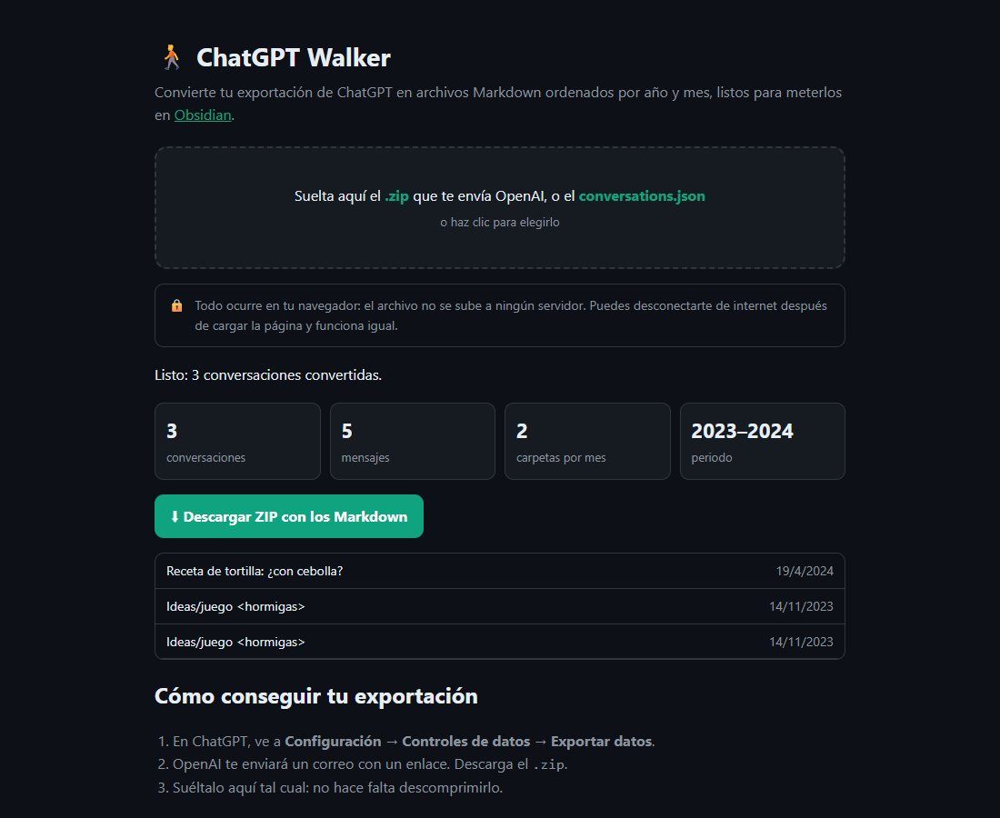
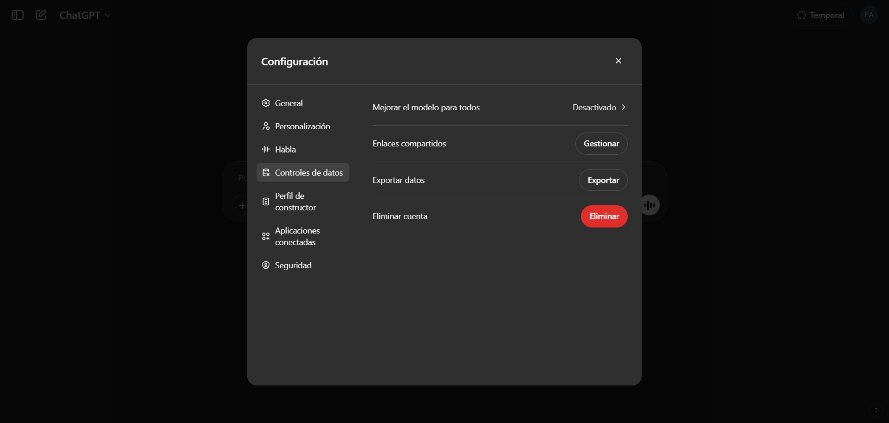
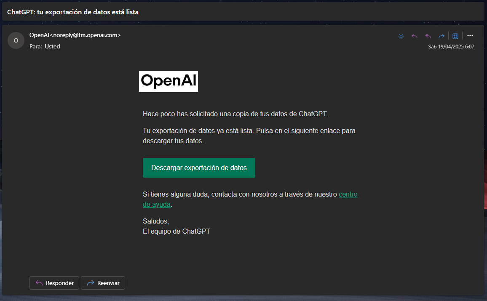

<p align="center"><a href="README.md">Español</a> · <b>English</b></p>

# ChatGPT Walker

Turn your ChatGPT conversations into Markdown files organized by date, with a clear and readable format optimized for importing into [Obsidian](https://obsidian.md/).

[](https://virtuanista.github.io/chatgpt-walker/)

## Web version (the easiest way)

Go to **[virtuanista.github.io/chatgpt-walker](https://virtuanista.github.io/chatgpt-walker/)**, drop in the `.zip` that OpenAI sends you (no need to unzip it) and download another `.zip` with all the Markdown files, organized just as with the script. **Everything happens in your browser**: your conversations are not uploaded to any server. The code is in [`web/index.html`](web/index.html).



## Instructions (Python script)

### 1. Export your ChatGPT conversations

1. Go to [ChatGPT Settings &gt; Data Controls](https://chatgpt.com/#settings/DataControls)
2. Click "Export data":



3. You will receive an email from OpenAI with the download link
4. Download and unzip the file:



### 2. Set up the project (IMPORTANT)

1. Clone or download this repository
2. Drag the `conversations.json` file you downloaded into the `chatgpt-walker` project directory, so that the structure looks like this:

```
chatgpt-walker/
├── conversations.json (you must add this file)
├── walker.py (you must run this script)
├── README.md
├── LICENSE
├── export_conversations.PNG
├── download_conversations.PNG
```

### 3. Run the script

The script will create:

- An `output` folder with subfolders organized by year, month and month name in Spanish (example: `2024_04_abril`)
- Markdown files for each conversation, keeping:
  - Original titles (including accents and ñ)
  - Message formatting with emojis for better readability
  - Precise timestamps and the date at the start of the file name for chronological order
- A `pruned.json` file with a summary of all conversations

Each Markdown file contains:

- Conversation title
- Messages formatted with:
  - User questions (🙍‍♂️ Usuario:)
  - ChatGPT answers (🤖 ChatGPT:)

### 4. Import into Obsidian

To import the conversations into your Obsidian vault:

1. Open your Obsidian vault
2. Copy all the contents of the `output` folder (except `pruned.json`)
3. Paste them into your Obsidian vault
   - You can create a specific folder such as "ChatGPT" to keep everything organized
   - The folder structure by year and month will stay intact

The files are already in Obsidian-compatible Markdown, so:

- Internal links will work automatically
- You can use the graph view to see connections
- Code formatting and images will display correctly
- You can use all of Obsidian's plugins and features to find insights

## License

<p align="center">
	Repository made by <a href="https://github.com/virtuanista" target="_blank">virtu 🎣</a>
</p>

<p align="center">
	
</p>

<p align="center">
	Copyright © 2025
</p>

<p align="center">
	<a href="/LICENSE"></a>
</p>
